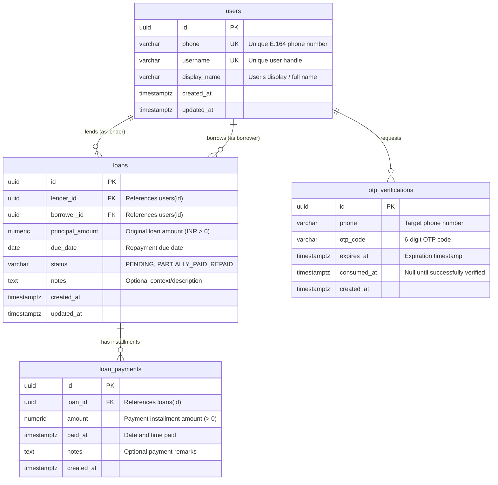

# MiniLedger — Database Schema & Architecture

This document describes the PostgreSQL database schema for **MiniLedger**, an application designed to track loans, installments, and repayment metrics between friends.

---

## 1. Entity-Relationship Diagram (ERD)



---

## 2. Table Specifications & DDL

### 2.1. `users`
Stores user profile information. Authentication is passwordless via phone numbers.

| Column | Type | Constraints | Description |
|---|---|---|---|
| `id` | `UUID` | `PRIMARY KEY DEFAULT gen_random_uuid()` | Unique user identifier |
| `phone` | `VARCHAR(20)` | `NOT NULL UNIQUE` | Phone number (E.164 standard) |
| `username` | `VARCHAR(50)` | `NOT NULL UNIQUE` | Unique handle for referencing friends |
| `display_name` | `VARCHAR(100)` | `NOT NULL` | Name displayed across the app |
| `created_at` | `TIMESTAMPTZ` | `NOT NULL DEFAULT NOW()` | Record creation timestamp |
| `updated_at` | `TIMESTAMPTZ` | `NOT NULL DEFAULT NOW()` | Record last update timestamp |

```sql
CREATE TABLE users (
    id UUID PRIMARY KEY DEFAULT gen_random_uuid(),
    phone VARCHAR(20) NOT NULL UNIQUE,
    username VARCHAR(50) NOT NULL UNIQUE,
    display_name VARCHAR(100) NOT NULL,
    created_at TIMESTAMPTZ NOT NULL DEFAULT NOW(),
    updated_at TIMESTAMPTZ NOT NULL DEFAULT NOW()
);

CREATE INDEX idx_users_phone ON users(phone);
CREATE INDEX idx_users_username ON users(username);
```

---

### 2.2. `otp_verifications`
Tracks OTP requests for passwordless phone login. OTPs are generated, printed to the server log (mock OTP), and verified here.

| Column | Type | Constraints | Description |
|---|---|---|---|
| `id` | `UUID` | `PRIMARY KEY DEFAULT gen_random_uuid()` | Unique OTP request ID |
| `phone` | `VARCHAR(20)` | `NOT NULL` | Phone number requesting login |
| `otp_code` | `VARCHAR(6)` | `NOT NULL` | 6-digit mock OTP |
| `expires_at` | `TIMESTAMPTZ` | `NOT NULL` | OTP expiry (e.g., 5-10 minutes from creation) |
| `consumed_at` | `TIMESTAMPTZ` | `NULL` | Timestamp when OTP was consumed (prevents replay) |
| `created_at` | `TIMESTAMPTZ` | `NOT NULL DEFAULT NOW()` | Timestamp when OTP was issued |

```sql
CREATE TABLE otp_verifications (
    id UUID PRIMARY KEY DEFAULT gen_random_uuid(),
    phone VARCHAR(20) NOT NULL,
    otp_code VARCHAR(6) NOT NULL,
    expires_at TIMESTAMPTZ NOT NULL,
    consumed_at TIMESTAMPTZ,
    created_at TIMESTAMPTZ NOT NULL DEFAULT NOW()
);

CREATE INDEX idx_otp_phone_active ON otp_verifications(phone, expires_at) 
WHERE consumed_at IS NULL;
```

---

### 2.3. `loans`
Records each loan contract between a lender and a borrower.

| Column | Type | Constraints | Description |
|---|---|---|---|
| `id` | `UUID` | `PRIMARY KEY DEFAULT gen_random_uuid()` | Unique loan ID |
| `lender_id` | `UUID` | `NOT NULL REFERENCES users(id) ON DELETE RESTRICT` | User who provided the loan |
| `borrower_id` | `UUID` | `NOT NULL REFERENCES users(id) ON DELETE RESTRICT` | User who received the loan |
| `principal_amount` | `NUMERIC(12, 2)` | `NOT NULL CHECK (principal_amount > 0)` | Principal amount lent |
| `due_date` | `DATE` | `NOT NULL` | Agreed due date for repayment |
| `status` | `loan_status` | `NOT NULL DEFAULT 'PENDING'` | `'PENDING'`, `'PARTIALLY_PAID'`, `'REPAID'` |
| `notes` | `TEXT` | `NULL` | Optional loan description |
| `created_at` | `TIMESTAMPTZ` | `NOT NULL DEFAULT NOW()` | Record creation timestamp |
| `updated_at` | `TIMESTAMPTZ` | `NOT NULL DEFAULT NOW()` | Record last update timestamp |

```sql
CREATE TYPE loan_status AS ENUM ('PENDING', 'PARTIALLY_PAID', 'REPAID');

CREATE TABLE loans (
    id UUID PRIMARY KEY DEFAULT gen_random_uuid(),
    lender_id UUID NOT NULL REFERENCES users(id) ON DELETE RESTRICT,
    borrower_id UUID NOT NULL REFERENCES users(id) ON DELETE RESTRICT,
    principal_amount NUMERIC(12, 2) NOT NULL CHECK (principal_amount > 0),
    due_date DATE NOT NULL,
    status loan_status NOT NULL DEFAULT 'PENDING',
    notes TEXT,
    created_at TIMESTAMPTZ NOT NULL DEFAULT NOW(),
    updated_at TIMESTAMPTZ NOT NULL DEFAULT NOW(),
    
    CONSTRAINT chk_different_lender_borrower CHECK (lender_id <> borrower_id)
);

CREATE INDEX idx_loans_lender ON loans(lender_id, status);
CREATE INDEX idx_loans_borrower ON loans(borrower_id, status);
CREATE INDEX idx_loans_lender_due_date ON loans(lender_id, due_date);
```

---

### 2.4. `loan_payments`
Stores each repayment installment made towards a specific loan.

| Column | Type | Constraints | Description |
|---|---|---|---|
| `id` | `UUID` | `PRIMARY KEY DEFAULT gen_random_uuid()` | Unique payment ID |
| `loan_id` | `UUID` | `NOT NULL REFERENCES loans(id) ON DELETE CASCADE` | Associated loan |
| `amount` | `NUMERIC(12, 2)` | `NOT NULL CHECK (amount > 0)` | Amount repaid in this transaction |
| `paid_at` | `TIMESTAMPTZ` | `NOT NULL DEFAULT NOW()` | Timestamp of payment |
| `notes` | `TEXT` | `NULL` | Optional transaction note |
| `created_at` | `TIMESTAMPTZ` | `NOT NULL DEFAULT NOW()` | Record creation timestamp |

```sql
CREATE TABLE loan_payments (
    id UUID PRIMARY KEY DEFAULT gen_random_uuid(),
    loan_id UUID NOT NULL REFERENCES loans(id) ON DELETE CASCADE,
    amount NUMERIC(12, 2) NOT NULL CHECK (amount > 0),
    paid_at TIMESTAMPTZ NOT NULL DEFAULT NOW(),
    notes TEXT,
    created_at TIMESTAMPTZ NOT NULL DEFAULT NOW()
);

CREATE INDEX idx_loan_payments_loan_id ON loan_payments(loan_id);
```

---

## 3. Business Logic & State Transitions

When a repayment installment is recorded in `loan_payments`:
1. Calculate `total_paid = SUM(amount)` for the loan.
2. Determine new status:
   - If `total_paid >= principal_amount` ➔ `status = 'REPAID'`
   - Else if `total_paid > 0` ➔ `status = 'PARTIALLY_PAID'`
   - Else ➔ `status = 'PENDING'`
3. Update `loans.status` and `loans.updated_at`.

---

## 4. Summary Metrics Query

For a lender querying their dashboard summary (`total_lent`, `total_repaid`, `overdue_amount`):

```sql
WITH loan_summaries AS (
    SELECT 
        l.id,
        l.principal_amount,
        l.due_date,
        l.status,
        COALESCE(SUM(p.amount), 0) AS total_paid,
        GREATEST(0, l.principal_amount - COALESCE(SUM(p.amount), 0)) AS remaining_balance
    FROM loans l
    LEFT JOIN loan_payments p ON l.id = p.loan_id
    WHERE l.lender_id = $1
    GROUP BY l.id, l.principal_amount, l.due_date, l.status
)
SELECT 
    COALESCE(SUM(principal_amount), 0) AS total_lent,
    COALESCE(SUM(total_paid), 0) AS total_repaid,
    COALESCE(
        SUM(
            CASE 
                WHEN status <> 'REPAID' AND due_date < CURRENT_DATE 
                THEN remaining_balance 
                ELSE 0 
            END
        ), 0
    ) AS overdue_amount
FROM loan_summaries;
```
